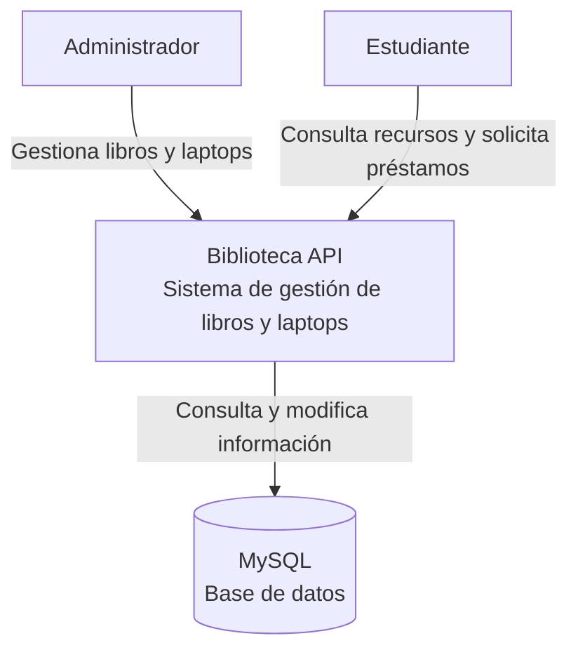
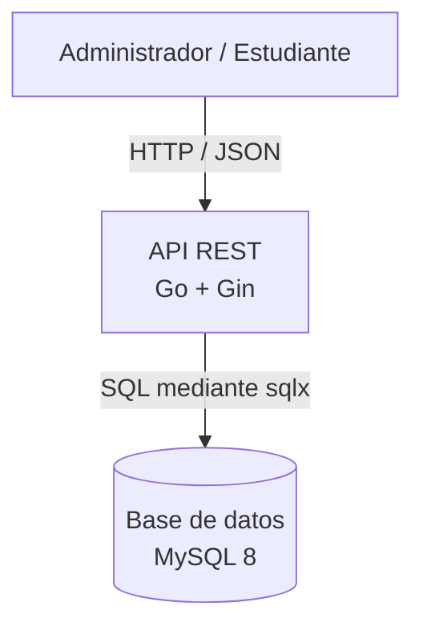
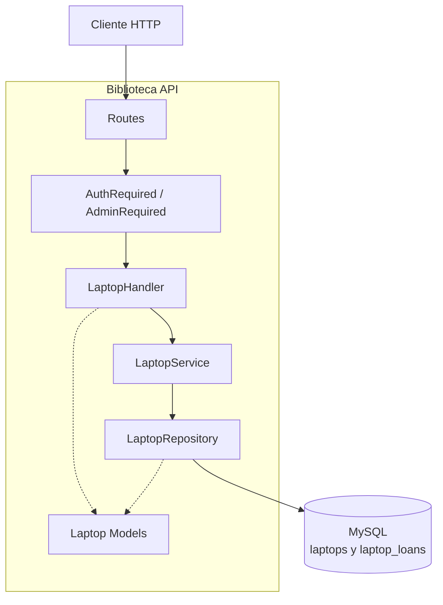
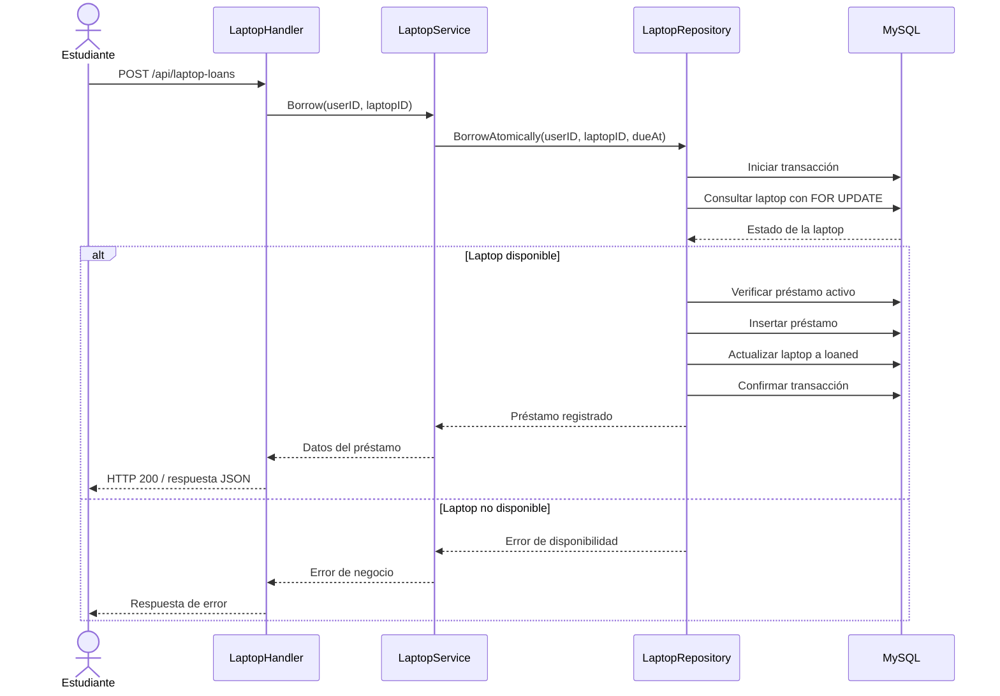
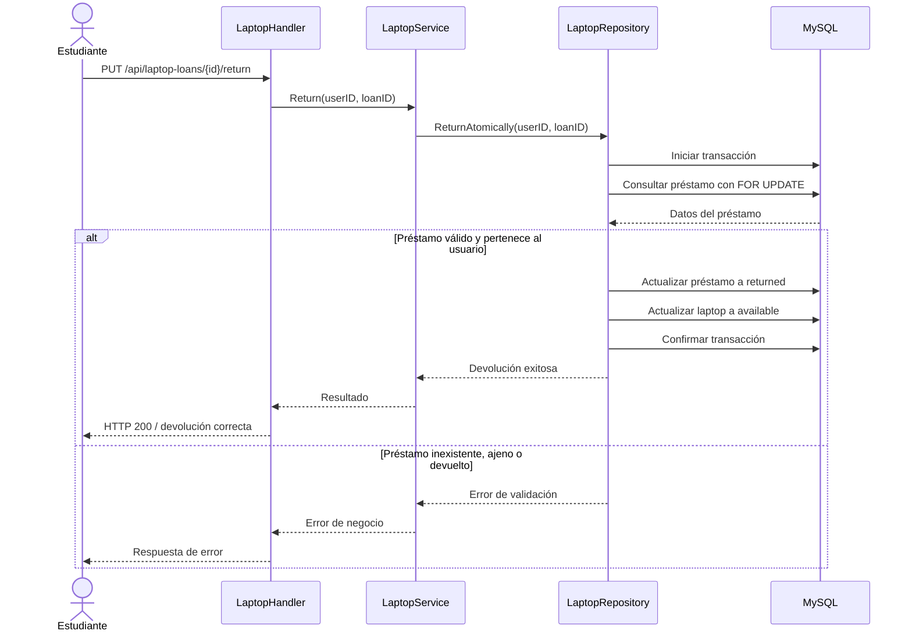

# Diagramas de arquitectura – Biblioteca API

## 1. Diagrama C4 – Nivel 1: Contexto del sistema

Este diagrama representa el sistema Biblioteca API y las personas que interactúan con él.

## 2. Diagrama C4 – Nivel 2: Contenedores

Representa los principales contenedores tecnológicos que componen la aplicación.

## 3. Diagrama C4 – Nivel 3: Componentes

Representa la organización interna del módulo de laptops y su comunicación con las demás capas.

## 4. Diagrama de secuencia – Préstamo de laptop

Representa el proceso que ocurre cuando un estudiante solicita una laptop.

## 5. Diagrama de secuencia – Devolución de laptop

Representa el proceso de devolución de una laptop prestada.

## 6. Explicación general

La arquitectura mantiene una separación por capas. Las solicitudes ingresan por las rutas HTTP y pasan por los middlewares de autenticación y autorización.

Después llegan al handler, que recibe y valida los datos de la solicitud. El service aplica las reglas de negocio y el repository ejecuta las operaciones sobre MySQL.

Las transacciones permiten que el registro del préstamo y la actualización del inventario se realicen de manera consistente. Si una operación falla antes